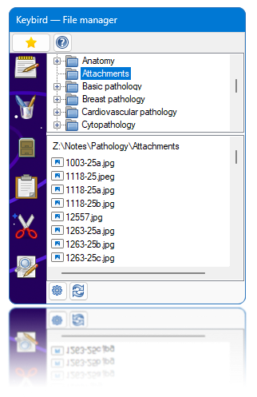

  

<h1 align="center">Keybird</h1>

A small, modular AutoHotkey companion for day-to-day report writing.

  

> [!NOTE]
> Keybird is a small, modular, utility program that aims to aid the user in day-to-day report writing by providing text expansion, boilerplate text snippets and other tools via an extensible plugin interface. The program leverages AutoHotkey's powerful scripting while providing an easily understandable and always-present interface.
> his is a continuation of my AHKV1-based MedMacros script (archived repo).

## Core functions
### Plugin architecture
Keybird's core goal is to provide a multi-function, extensible and small interface that's always accessible. Think of it as small Swiss army knife for everyday tasks, except you can add or remove tools as needed. This is achieved via an "addon" system, which is a small script loader with hooks that trigger your script during specific moments. See *docs/Developer*.

### Hotkey manager
Keybird and its addons can register hotkeys via a centralized manager that lets the user customize and activate or deactivate them (see *settings* section).

### The main window
Keybird's main window (pictured above) consists of a simple, tabbed interface, with some buttons that act as a menu bar.

> [!NOTE]
> **Special window properties**
>
> The main window can be configured to stay always on top, and to be transparent when not in focus. It can also be set to hide/unhide using a hotkey or another trigger, or it can be minimized to the taskbar if you prefer that method (see *settings* section).

#### Tab switcher
The tab switcher contains all functions that can be quickly accessed in the main window. Most of these are provided via addons, and have varied functions, such as a to-do list, a notepad, or other utilities.
The "tabs" (represented by the icons), can also be right-clicked for extra options and for performing quick tasks.
The tab switcher can be customized. You can add a background image in settings (see *settings* section).

### System tray
Besides hotkeys, you can quickly interact with Keybird via the system tray menu. Common options are shown here, and can be triggered even when the main window is hidden.

### System functions
#### Stay awake
A toggleable function that prevents the system from suspending or going to the lockscreen. This function can be triggered from the main menu, or from the system tray menu.

## Credits
### GUI functions
- [Keep gui over the taskbar](https://tinyurl.com/plankoe-did-this), by plankoe-did-this

### Libraries
- [RichEdit.ahk / RichEditDlgs.ahk](http://www.autohotkey.com/board/topic/17869-crichedit-standard-richedit-control-for-autohotkey-scripts/), by just me
	- HE_Print by [jballi](http://www.autohotkey.com/board/topic/45513-function-he-print-wysiwyg-print-for-the-hiedit-control/)
	- Dlg 5.01 by [majkinetor](http://www.autohotkey.com/board/topic/15836-module-dlg-501/)
	- Modified for Keybird: __Delete() garbage collection after gui destruction.
- [ListViewExtensions.ahk](https://www.autohotkey.com/boards/), by just me
	- GuiControl_Ex concept by [TheArkive](https://www.autohotkey.com/boards/viewtopic.php?f=83&t=86124)
	- Tile-view functions: idea by segalion, based on code by Fabio Lucarelli
- [GuiButtonIcon.ahk](https://www.autohotkey.com/boards/), by Fanatic Guru
- [Gdip_All.ahk](https://www.autohotkey.com/boards/) — AutoHotkey GDI+ wrapper, community-maintained
	- Version maintained by Rseding91
	- v2 port by guest3456
	- MDMF monitor functions by just me
	- WinGetRect based on work by dd900 and Frosti

### Resources
- [Tango Desktop Project, Icons for Everyone](https://tekeye.uk/free_resources/tango_desktop_project/index)

## AI disclosure
Parts of Keybird's code were written and debugged with the assistance of Claude (Anthropic).
All AI-assisted code was reviewed, tested, and edited by the maintainer.
